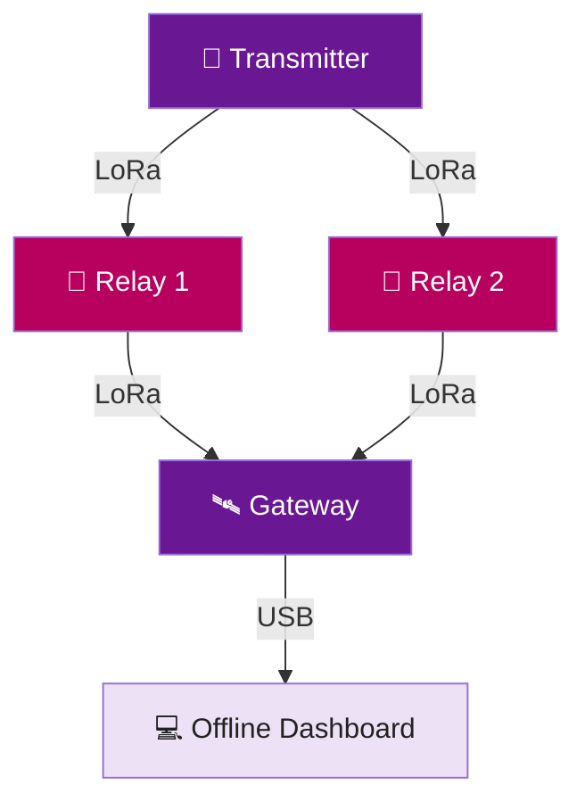

# 🔌 ResQMesh
### Hardware Connections & Configuration

**ESP32 • SX1278 LoRa • Redundant Relay Network**

*IEEE WIE ILS 2026 | HackX Grand Finale*

---

## 📡 1. Hardware Overview

ResQMesh consists of **four ESP32-based nodes** that communicate wirelessly using **SX1278 LoRa modules**.

| Node | Components | Purpose |
|---|---|---|
| 🚨 **Transmitter** | ESP32, LoRa, OLED, 4 Buttons, 2 LEDs | Sends emergency alerts |
| 📡 **Relay 1** | ESP32, LoRa | Forwards emergency packets |
| 📡 **Relay 2** | ESP32, LoRa | Provides an alternative communication path |
| 🛰️ **Gateway** | ESP32, LoRa, USB | Sends received alerts to the dashboard |

---

## 🔌 2. LoRa Module Connections

**All four ESP32 nodes use the same SX1278 connections.**

| SX1278 Pin | ESP32 Pin | Function |
|---|---|---|
| VCC | 3V3 | Power |
| GND | GND | Ground |
| SCK | GPIO18 | SPI Clock |
| MISO | GPIO19 | SPI Data |
| MOSI | GPIO23 | SPI Data |
| NSS / CS | GPIO5 | Chip Select |
| RST | GPIO14 | Reset |
| DIO0 | GPIO26 | Interrupt |

> ⚠️ **Important:** SX1278 operates at **3.3 V**. Do not connect it directly to 5 V. Use a compatible antenna and verify local frequency regulations.

---

## 🚨 3. Transmitter Connections

The transmitter includes **four emergency buttons, an OLED display, and two status LEDs**.

### Emergency Buttons

| Button | ESP32 GPIO | Priority |
|---|---|---|
| 🆘 SOS | GPIO25 | Critical |
| 🏥 Medical | GPIO27 | Critical |
| 🛟 Rescue | GPIO32 | High |
| 📦 Supplies | GPIO4 | Medium |

**Wiring:** Connect each button between its assigned GPIO and GND. The firmware uses `INPUT_PULLUP`.

### OLED Display (I²C)

| OLED Pin | ESP32 Pin |
|---|---|
| VCC | 3V3 |
| GND | GND |
| SDA | GPIO21 |
| SCL | GPIO22 |

**Display:** SSD1306, 128×64, I²C address `0x3C`.

### Status LEDs

| LED | ESP32 GPIO | Purpose |
|---|---|---|
| 🔴 Red | GPIO16 | Transmission indicator |
| 🟢 Green | GPIO17 | Acknowledgement indicator |

Connect each LED through a **330 Ω current-limiting resistor** to its GPIO, with the cathode connected to GND.

---

## 📡 4. Relay Connections

Both relay nodes use the **same ESP32-to-LoRa connections** listed in Section 2.

- **RELAY_01:** Receives and forwards emergency packets.
- **RELAY_02:** Provides an independent forwarding path.

Each relay requires:

- 1 × ESP32
- 1 × SX1278 LoRa module
- 1 × Compatible antenna
- 1 × Suitable power supply

> 💡 If one relay becomes unavailable, the other can continue forwarding packets when the required radio links are available.

---

## 🛰️ 5. Gateway Connections

The gateway uses the **same LoRa wiring** as both relay nodes.

It connects to a laptop using a **USB data cable**.

| Parameter | Configuration |
|---|---|
| Interface | USB Serial |
| Baud Rate | **115200** |
| Backend | Python |
| Dashboard | Streamlit |
| Database | SQLite |

The gateway receives LoRa emergency packets and forwards event information to the offline dashboard.

---

## 🏗️ 6. Network Architecture

**Both relays provide alternative paths between the transmitter and gateway.**

---

## ⚙️ 7. LoRa Configuration

All four nodes must use matching radio settings.

| Parameter | Value |
|---|---|
| Frequency | **433 MHz** |
| Spreading Factor | SF7 |
| Bandwidth | 125 kHz |
| Coding Rate | 4/5 |
| Sync Word | `0x12` |
| Communication Interface | SPI |

---

## 🧪 8. Basic Hardware Testing

1. **Power on** all four ESP32 nodes.
2. **Verify** that each LoRa module initializes successfully.
3. **Press** an emergency button on the transmitter.
4. **Check** whether the gateway receives the alert.
5. **Disconnect Relay 1** and test communication through Relay 2.
6. **Reconnect Relay 1**, disconnect Relay 2, and repeat.
7. **Verify** that the emergency appears on the offline dashboard.

> **Note:** ResQMesh is an experimental prototype. Communication reliability depends on radio coverage, interference, and hardware conditions.

---

### 🚨 ResQMesh

**When Networks Fail, Communication Shouldn't.**

*Offline Emergency Communication Using LoRa*

