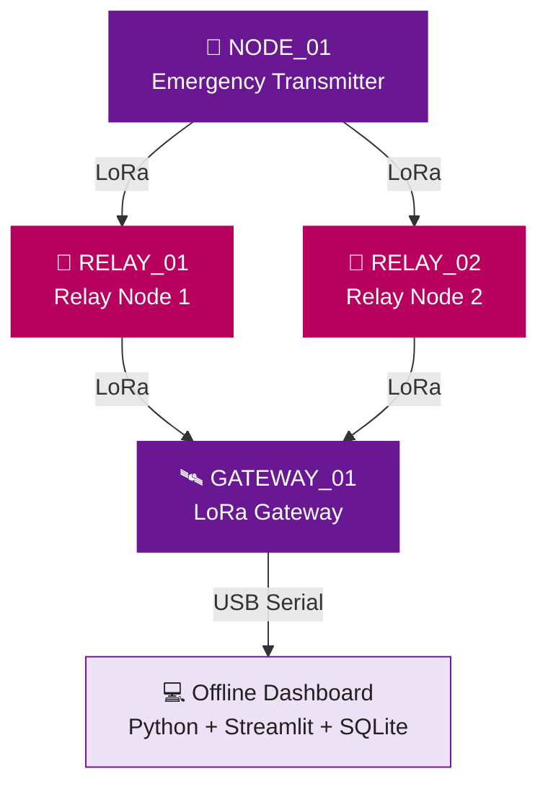

<div align="center">

# 🔌 RESQMESH
## Hardware Connections & Circuit Documentation

### 📡 Offline • Decentralized • Fault-Tolerant Emergency Communication

**ESP32 | SX1278 LoRa | Redundant Relay Network**

---

**IEEE WIE ILS 2026 | HackX Grand Finale | SVNIT Surat**

</div>

---

## 📌 1. Hardware Overview

**ResQMesh** is an offline emergency communication prototype built using **ESP32 microcontrollers** and **SX1278 LoRa transceivers**.

The system consists of **four independent nodes**:

| Node | Hardware | Function |
|:---:|---|---|
| 🚨 **NODE_01** | ESP32 + LoRa + OLED + Buttons + LEDs | Emergency transmitter |
| 📡 **RELAY_01** | ESP32 + LoRa | Primary forwarding node |
| 📡 **RELAY_02** | ESP32 + LoRa | Redundant forwarding node |
| 🖥️ **GATEWAY_01** | ESP32 + LoRa + USB | Emergency gateway |

> 💡 **Key Innovation:** Two independent relay nodes provide alternative communication paths. If one relay goes offline, the other can continue forwarding emergency messages, provided a working wireless path exists.

---

## 🏗️ 2. System Architecture



### 🔄 Network Operation

**Emergency communication:**

`NODE_01 → RELAY_01 / RELAY_02 → GATEWAY_01 → Dashboard`

**Acknowledgement communication:**

`GATEWAY_01 → Available Relay → NODE_01`

Both relays operate independently.

---

## 📡 3. SX1278 LoRa Module Connections

All four ESP32 nodes use the **same SX1278 wiring configuration**.

### 🔧 LoRa-to-ESP32 Pin Mapping

| SX1278 Pin | ESP32 GPIO | Function |
|:---:|:---:|---|
| **VCC** | **3V3** | 3.3 V power supply |
| **GND** | **GND** | Common ground |
| **SCK** | **GPIO18** | SPI clock |
| **MISO** | **GPIO19** | SPI data input |
| **MOSI** | **GPIO23** | SPI data output |
| **NSS / CS** | **GPIO5** | Chip select |
| **RST** | **GPIO14** | Module reset |
| **DIO0** | **GPIO26** | Radio interrupt |

### ⚠️ Important Precautions

- ✅ Use a regulated **3.3 V supply** for the SX1278.
- ❌ **Never connect SX1278 VCC directly to 5 V.**
- ✅ Attach a compatible antenna before transmitting.
- ✅ Verify the ESP32's 3.3 V regulator can supply the radio's peak current.
- ✅ Connect all components to a common ground.
- ✅ Use the same radio configuration on every node.
- ✅ Verify that the operating frequency is permitted locally.

---

## 🚨 4. Emergency Transmitter — NODE_01

### 📦 Components

| Component | Quantity |
|---|:---:|
| ESP32 Development Board | 1 |
| SX1278 LoRa Module | 1 |
| 433 MHz Antenna | 1 |
| 128 × 64 OLED Display | 1 |
| Push Buttons | 4 |
| Red LED | 1 |
| Green LED | 1 |
| Current-Limiting Resistors | 2 |
| USB Power Supply | 1 |

### 🔴 4.1 Emergency Button Connections

| Button | ESP32 Pin | Emergency Type | Priority |
|---|:---:|---|:---:|
| 🔴 Button 1 | **GPIO25** | SOS | Critical |
| 🏥 Button 2 | **GPIO27** | Medical | Critical |
| 🛟 Button 3 | **GPIO32** | Rescue | High |
| 📦 Button 4 | **GPIO4** | Supplies | Medium |

**Button wiring:**

```text
ESP32 GPIO25 ───── SOS BUTTON ───── GND
ESP32 GPIO27 ─── MEDICAL BUTTON ─── GND
ESP32 GPIO32 ─── RESCUE BUTTON ──── GND
ESP32 GPIO4  ─── SUPPLIES BUTTON ── GND
```

The firmware uses:

```cpp
pinMode(BUTTON_PIN, INPUT_PULLUP);
```

Therefore:

- **Button released:** HIGH
- **Button pressed:** LOW

> ⚠️ GPIO4 is an ESP32 strapping pin. Avoid holding the Supplies button during startup or reset.

---

### 🖥️ 4.2 OLED Display Connections

**Display:** SSD1306 OLED  
**Resolution:** 128 × 64 pixels  
**Interface:** I²C  
**Address:** `0x3C`

| OLED Pin | ESP32 Connection |
|:---:|:---:|
| **VCC** | **3V3** |
| **GND** | **GND** |
| **SDA** | **GPIO21** |
| **SCL** | **GPIO22** |

**Connection diagram:**

```text
       OLED DISPLAY              ESP32

          VCC  ─────────────────  3V3
          GND  ─────────────────  GND
          SDA  ─────────────────  GPIO21
          SCL  ─────────────────  GPIO22
```

### OLED Status Messages

The display provides visual feedback during operation.

| Condition | Display Message |
|---|---|
| System initialized | `RESQMESH READY` |
| Emergency triggered | `SENDING SOS` |
| Waiting for confirmation | `Waiting for gateway ACK` |
| Acknowledgement received | `ACK SUCCESS` |
| Acknowledgement timeout | `NO GATEWAY ACK` |
| LoRa initialization failure | `LORA ERROR` |

---

### 💡 4.3 LED Connections

| LED | ESP32 Pin | Purpose |
|---|:---:|---|
| 🔴 **Red LED** | **GPIO16** | Emergency transmission indicator |
| 🟢 **Green LED** | **GPIO17** | Gateway acknowledgement indicator |

**Connection diagram:**

```text
GPIO16 ── 330Ω ── RED LED ───── GND

GPIO17 ── 330Ω ── GREEN LED ─── GND
```

Connect each LED's **anode (+)** toward the resistor and GPIO, and its **cathode (−)** to GND.

### LED Behavior

| System State | Red LED | Green LED |
|---|:---:|:---:|
| Ready | OFF | OFF |
| Emergency transmission | ON | OFF |
| Gateway acknowledgement received | OFF | ON |
| Reset to ready state | OFF | OFF |

---

### 📋 4.4 Complete Transmitter Pin Summary

| Component | ESP32 Pin |
|---|:---:|
| LoRa SCK | GPIO18 |
| LoRa MISO | GPIO19 |
| LoRa MOSI | GPIO23 |
| LoRa NSS | GPIO5 |
| LoRa RST | GPIO14 |
| LoRa DIO0 | GPIO26 |
| OLED SDA | GPIO21 |
| OLED SCL | GPIO22 |
| SOS Button | GPIO25 |
| Medical Button | GPIO27 |
| Rescue Button | GPIO32 |
| Supplies Button | GPIO4 |
| Red LED | GPIO16 |
| Green LED | GPIO17 |

---

## 📡 5. Relay Node 1 — RELAY_01

### 📦 Components

- 1 × ESP32 development board
- 1 × SX1278 LoRa transceiver
- 1 × Compatible antenna
- 1 × USB power supply

### 🔧 Wiring Connections

| SX1278 Pin | ESP32 Pin |
|:---:|:---:|
| VCC | 3V3 |
| GND | GND |
| SCK | GPIO18 |
| MISO | GPIO19 |
| MOSI | GPIO23 |
| NSS | GPIO5 |
| RST | GPIO14 |
| DIO0 | GPIO26 |

### ⚙️ Function

**RELAY_01**:

1. Receives emergency packets from nearby LoRa nodes.
2. Checks packet identifiers to suppress repeated forwarding.
3. Decreases the packet's time-to-live (TTL).
4. Forwards eligible emergency packets.
5. Rebroadcasts eligible gateway acknowledgements.
6. Uses randomized forwarding delays to reduce collision probability.

**Firmware identifier:**

```cpp
static const char *RELAY_ID = "RELAY_01";
```

---

## 📡 6. Relay Node 2 — RELAY_02

### 📦 Components

- 1 × ESP32 development board
- 1 × SX1278 LoRa transceiver
- 1 × Compatible antenna
- 1 × USB power supply

### 🔧 Wiring Connections

| SX1278 Pin | ESP32 Pin |
|:---:|:---:|
| VCC | 3V3 |
| GND | GND |
| SCK | GPIO18 |
| MISO | GPIO19 |
| MOSI | GPIO23 |
| NSS | GPIO5 |
| RST | GPIO14 |
| DIO0 | GPIO26 |

### ⚙️ Function

**RELAY_02** uses the same forwarding algorithm as Relay 1.

It operates independently and provides an alternative path for emergency packets.

**Firmware identifier:**

```cpp
static const char *RELAY_ID = "RELAY_02";
```

### 🔄 Redundant Relay Operation

| Relay 1 | Relay 2 | Expected Communication |
|:---:|:---:|---|
| 🟢 Online | 🟢 Online | Both forwarding paths available |
| 🔴 Offline | 🟢 Online | Relay 2 can forward |
| 🟢 Online | 🔴 Offline | Relay 1 can forward |
| 🔴 Offline | 🔴 Offline | No relay path available |

> **Note:** The surviving relay must have a working radio connection to the transmitter and gateway. Direct transmitter-to-gateway communication may still be possible when both relays are offline.

---

## 🛰️ 7. Gateway Node — GATEWAY_01

### 📦 Components

- 1 × ESP32 development board
- 1 × SX1278 LoRa module
- 1 × Compatible antenna
- 1 × USB data cable
- 1 × Laptop running the dashboard

### 🔧 Gateway LoRa Connections

| SX1278 Pin | ESP32 Pin |
|:---:|:---:|
| VCC | 3V3 |
| GND | GND |
| SCK | GPIO18 |
| MISO | GPIO19 |
| MOSI | GPIO23 |
| NSS | GPIO5 |
| RST | GPIO14 |
| DIO0 | GPIO26 |

### 💻 Gateway-to-Laptop Connection

```text
       LoRa Gateway
       ESP32 + SX1278
              |
              |
         USB Data Cable
              |
              ▼
       Laptop / Computer
              |
              ▼
       Python Serial Reader
              |
              ▼
       SQLite Database
              |
              ▼
       Streamlit Dashboard
```

### Serial Communication Configuration

| Parameter | Configuration |
|---|---|
| Communication interface | USB Serial |
| Baud rate | **115200** |
| Gateway software | Arduino C++ |
| Laptop software | Python |
| Serial library | PySerial |
| Dashboard | Streamlit |
| Database | SQLite |

### Gateway Responsibilities

- Receive emergency packets.
- Identify the originating transmitter.
- Record the last forwarding node.
- Suppress duplicate dashboard alerts.
- Send gateway acknowledgements.
- Transfer emergency events to the local dashboard.

---

## ⚙️ 8. LoRa Radio Configuration

All four nodes must use matching radio settings.

| Parameter | Value |
|---|---|
| **LoRa Module** | SX1278 |
| **Operating Frequency** | 433 MHz |
| **Spreading Factor** | SF7 |
| **Bandwidth** | 125 kHz |
| **Coding Rate** | 4/5 |
| **Sync Word** | `0x12` |
| **Communication Mode** | Half-duplex |
| **Interface** | SPI |

### Arduino Configuration

```cpp
LoRa.setSpreadingFactor(7);
LoRa.setSignalBandwidth(125E3);
LoRa.setCodingRate4(5);
LoRa.setSyncWord(0x12);
```

---

## 🔋 9. Power Distribution

### Power Architecture

```text
USB Power Supply
       |
       ▼
     ESP32
       |
       ├──────── 3.3V ─────── SX1278 LoRa
       |
       ├──────── 3.3V ─────── OLED (Transmitter)
       |
       ├──────── GPIO ─────── Buttons
       |
       └──────── GPIO ─────── LEDs
```

### Power Requirements

| Component | Supply |
|---|---|
| ESP32 Development Board | Suitable USB power |
| SX1278 LoRa Module | Regulated 3.3 V |
| OLED Display | 3.3 V, if supported by the module |
| Push Buttons | GPIO input with internal pull-up |
| LEDs | GPIO output through resistors |

> ⚠️ Ensure that the ESP32 board's 3.3 V regulator can provide enough current for the LoRa module, especially during transmission.

---

## 🧪 10. Hardware Testing Procedure

### Test 1 — Individual Node Initialization

Power each ESP32 independently.

Verify:

- ESP32 starts successfully.
- SX1278 initializes.
- Serial Monitor displays the correct node identifier.
- No LoRa initialization errors appear.

### Test 2 — Emergency Transmission

1. Power on all four nodes.
2. Press the SOS button.
3. Confirm that the transmitter sends a packet.
4. Verify that the gateway receives the emergency.

### Test 3 — Relay 1 Failure

1. Keep Relay 2 powered on.
2. Disconnect Relay 1.
3. Trigger another emergency.
4. Verify whether the gateway receives the packet through `RELAY_02`.

### Test 4 — Relay 2 Failure

1. Reconnect Relay 1.
2. Disconnect Relay 2.
3. Trigger another emergency.
4. Verify whether the gateway receives the packet through `RELAY_01`.

### Test 5 — Dashboard Integration

1. Connect the gateway ESP32 to the laptop.
2. Close Arduino Serial Monitor.
3. Start the Python gateway reader.
4. Start the Streamlit dashboard.
5. Trigger an emergency.
6. Verify that the dashboard displays the incident.

---

## 🛡️ 11. Design Considerations

| Feature | Implementation |
|---|---|
| **Offline Operation** | LoRa + local dashboard |
| **Redundant Communication** | Two independent relays |
| **Duplicate Suppression** | Packet ID caching |
| **Loop Reduction** | TTL-based forwarding |
| **Collision Mitigation** | Random forwarding delays |
| **Delivery Feedback** | Gateway acknowledgement |
| **Incident Storage** | Local SQLite database |

### Current Prototype Limitations

- Radio delivery is not guaranteed.
- LoRa transmissions may collide.
- Relay coverage determines failover availability.
- Configured location is used instead of GPS.
- The prototype does not currently implement encryption or authentication.
- The system is not certified for life-safety use.

---

<div align="center">

### 🚨 RESQMESH

**When Networks Fail, Communication Shouldn't.**

*Offline Emergency Communication Through Redundant LoRa Relays*

**IEEE WIE ILS 2026 · HackX Grand Finale · SVNIT Surat**

</div>
