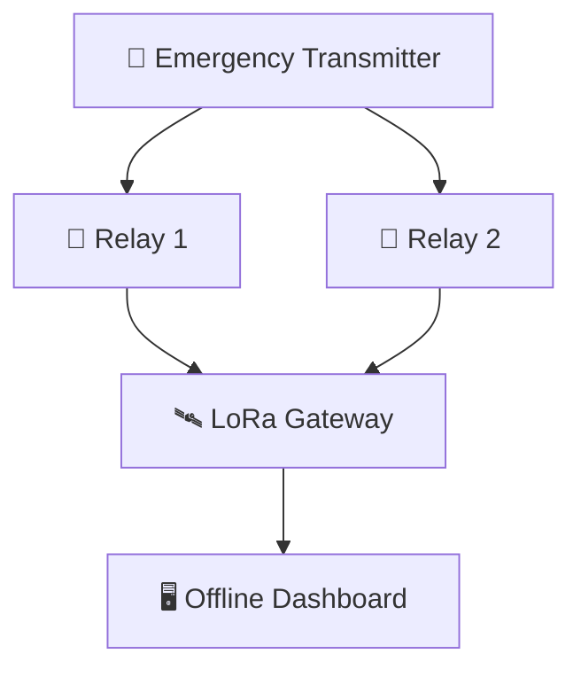

# 🚨 ResQMesh
### When Networks Fail, Communication Shouldn't.

**An Offline, Fault-Tolerant Emergency Communication Network**

**🏆 IEEE WIE ILS 2026 | HackX Grand Finale | SVNIT Surat**

---

## 🌍 The Problem

During natural disasters, conventional communication infrastructure may become **damaged, overloaded, or completely unavailable**.

People in remote and disaster-affected regions may struggle to send emergency alerts.

**Our mission:** Enable emergency communication even without internet or cellular connectivity.

---

## 💡 Our Solution

**ResQMesh** is a decentralized emergency communication prototype built using **ESP32 microcontrollers and SX1278 LoRa modules**.

### ✨ Key Features

- 📡 **Offline Communication:** No internet or cellular network required.
- 🔄 **Redundant Relay Nodes:** Communication can continue if one relay fails.
- 🚨 **Four Emergency Categories:** SOS, Medical, Rescue, Supplies.
- ✅ **Gateway Acknowledgements:** Confirmation of emergency reception.
- 🖥️ **Live Dashboard:** Real-time monitoring using Streamlit.
- 💾 **Local Database:** SQLite-based incident storage.

---

## 🔗 System Architecture

---

## 🛠️ Technology Stack

| Category | Technologies |
|---|---|
| **Microcontroller** | ESP32 |
| **Wireless Communication** | SX1278 LoRa |
| **Embedded Programming** | C++ |
| **Development Environment** | Arduino IDE |
| **Dashboard** | Python, Streamlit |
| **Database** | SQLite |
| **Serial Communication** | PySerial |

---

## 🎯 Expected Impact

**ResQMesh aims to provide:**

- Faster communication of emergency needs.
- Improved connectivity in remote locations.
- Reduced dependence on traditional communication infrastructure.
- A low-cost platform for emergency alerting.

---

## 🚀 Future Scope

- 📍 GPS-based location tracking.
- 🔐 Secure communication.
- 🔋 Battery-powered deployment.
- 🌐 Larger mesh networks.
- 📊 Advanced network monitoring.

---

**Developed for IEEE WIE ILS 2026 — HackX Grand Finale**
